<picture>
  <source media="(prefers-color-scheme: dark)" srcset="assets/banner-dark.svg">
  
</picture>

  
  
  
  

## About me

I'm an AI engineer with an **MSc in Computer Science from Blekinge Institute of Technology (BTH), Sweden**. I build and evaluate applications with large language models and machine learning, mostly in Python, and I like turning research results into tools people can use.

I'm looking for **AI Engineer, ML Engineer and Data Scientist** roles, and I can start immediately.

## Highlights

| | |
|---|---|
| 🏆 **Ericsson Build Hackathon 2026** | Part of the team that won **1st place in Ericsson's Data Storage Optimization challenge** (SEK 5,000) and placed 3rd overall. |
| 🔬 **LLMs for software security** | Co-authored a master's thesis with **RISE Research Institutes of Sweden**: 2,076 evaluations of Gemini 2.5 Pro and Qwen3-235B on 346 real vulnerabilities. |
| 📈 **Volvo Construction Equipment** | Built demand-forecasting pipelines and Python/Flask/Plotly dashboards in a SUGAR Network project with the University of São Paulo. |
| ☁️ **Cloud** | Preparing for the AWS Certified Solutions Architect – Associate exam. |

## Featured projects

<table>
  <tr>
    <td width="50%" valign="top">
      <h3><a href="https://github.com/VenkataVishnuVardhanReddy/Ericsson-Challenge">Distill</a></h3>
      🏆 1st place · Ericsson Data Storage Optimization challenge
      
Offline, privacy-first tool that shrank a 1.45 GB archive of meeting recordings and slide decks to 24.9 MB (98.3% smaller) while measuring what was kept.

      
Team project led by <a href="https://github.com/VenkataVishnuVardhanReddy">Venkata Vishnu Vardhan Reddy Gurram</a>. My part: parts of the AI/ML pipeline, some backend and storage, and the pitch.

      
<code>Python</code> <code>FastAPI</code> <code>OpenCV</code> <code>Faster-Whisper</code> <code>SQLite</code>

    </td>
    <td width="50%" valign="top">
      <h3><a href="https://github.com/JyothiMadhurya/thesis_vulnerability_analysis">Can LLMs find root causes?</a></h3>
      🔬 MSc thesis · RISE &amp; BTH
      
A CVE-grounded framework that tests whether LLMs can locate and explain the root cause of real software vulnerabilities, and how much context they need.

      
346 vulnerability-fix pairs · 2,076 evaluations · 3 prompting strategies. Co-authored with Venkata Vishnu Vardhan Reddy Gurram.

      
<code>Python</code> <code>Gemini 2.5 Pro</code> <code>Qwen3</code> <code>CVE/CWE</code>

    </td>
  </tr>
  <tr>
    <td width="50%" valign="top">
      <h3><a href="https://github.com/JyothiMadhurya/Disease-Prediction">Disease Prediction</a></h3>
      🩺 Machine learning · NLP
      
Predicts likely diseases from a list of symptoms and recommends treatments, using TF-IDF features and ensemble (stacking) classifiers.

      
<code>Python</code> <code>scikit-learn</code> <code>Pandas</code> <code>Jupyter</code>

    </td>
    <td width="50%" valign="top">
      <h3><a href="https://github.com/JyothiMadhurya/Spam-Classification">Spam Classification</a></h3>
      ✉️ Machine learning · Text classification
      
A classifier that separates spam from legitimate messages.

      
<code>Python</code> <code>Jupyter</code>

    </td>
  </tr>
</table>

## Tech stack

**AI & machine learning** 

**Engineering & cloud** 

## Let's connect

I'm happy to talk about AI engineering roles, LLM evaluation or anything in this profile. The fastest way to reach me is [LinkedIn](https://www.linkedin.com/in/jyothi-madhurya-nalam) or [email](mailto:nmadhurya6@gmail.com).
